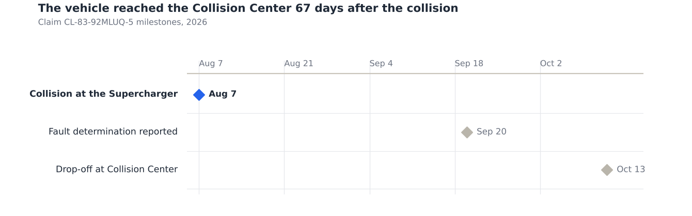
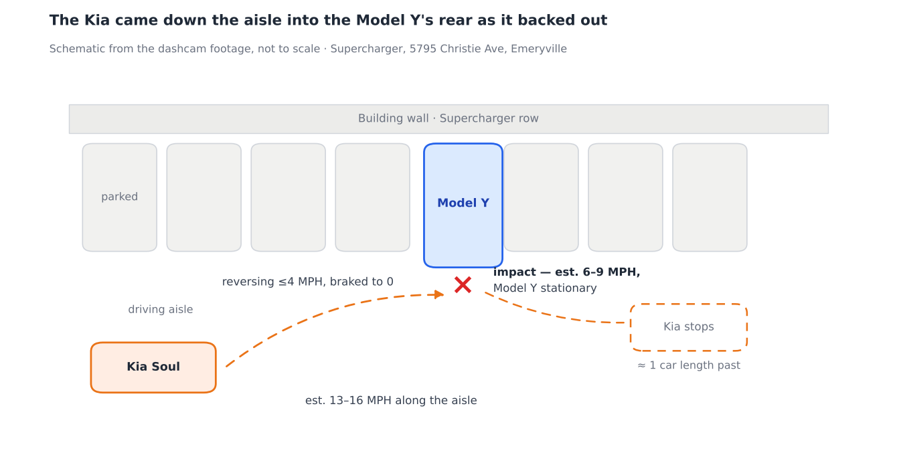
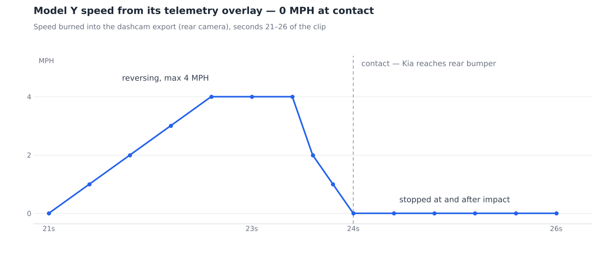
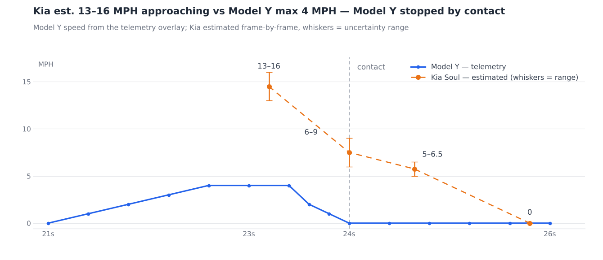
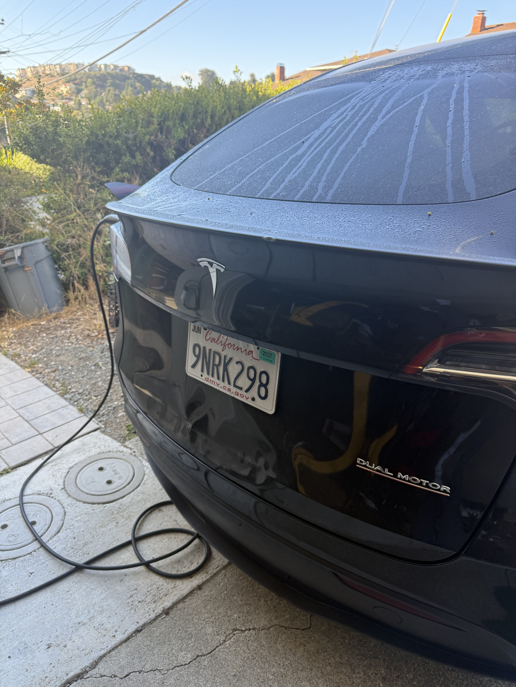
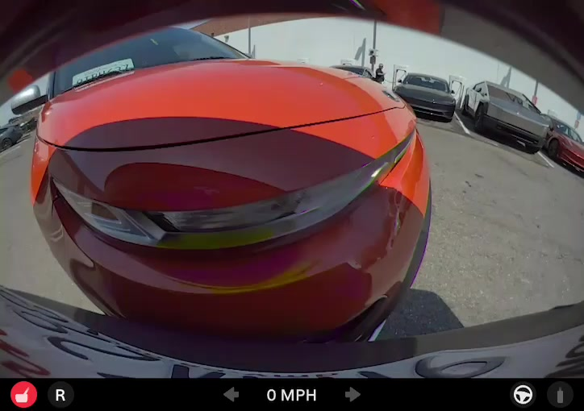
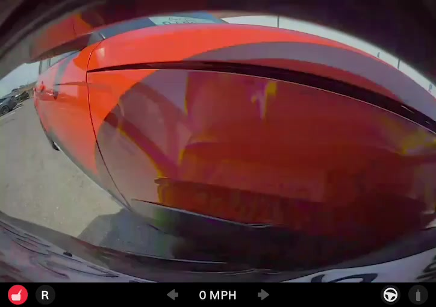
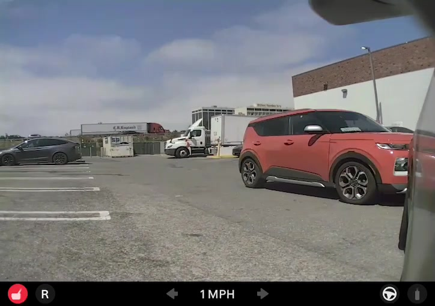
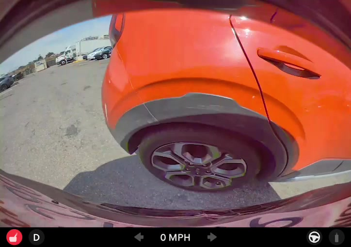
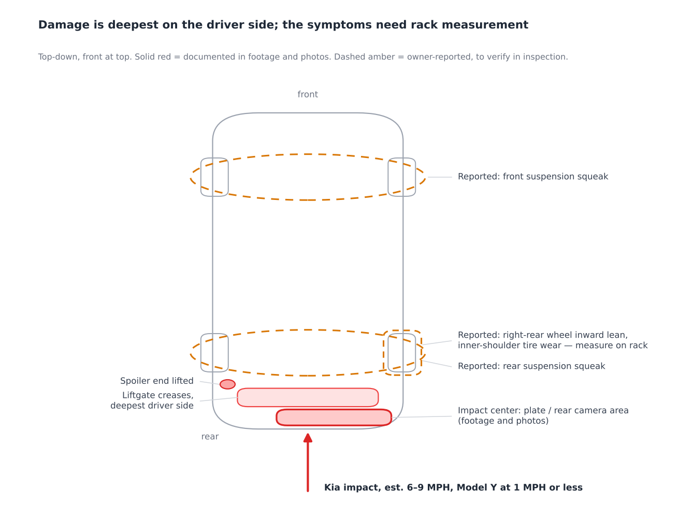

# Collision Damage Report — 2021 Tesla Model Y

Oct 13, 2026 · Live version: https://claude.ai/code/artifact/ec42f30f-250e-4e31-abc3-9a4d41efe38b

## Summary

On August 7, 2026 at 11:46 AM, the 2021 Tesla Model Y (black, CA plate 9NRK298, VIN 5YJYGDEF1MF197013) was struck in the rear by a red Kia Soul at the Tesla Supercharger at 5795 Christie Avenue, Emeryville, CA. Dashcam footage with Tesla's own telemetry overlay shows the Model Y reversing out of a stall at no more than 4 MPH, braking to 1 MPH as the Kia's front corner arrived, and holding at 0 MPH through the impact. The Kia, approaching along the driving aisle at an estimated 13–16 MPH and braking late, struck the nearly stopped Model Y's rear liftgate and bumper at an estimated 6–9 MPH, slid across the full rear of the vehicle, and stopped roughly one car length beyond. The impact is centered on the license plate and backup-camera area, matching the panel deformation documented in photographs taken 9 and 24 minutes after the collision.

This report is prepared for the Tesla Collision Center at vehicle drop-off. Speed figures marked as estimates are derived from frame-by-frame video analysis; the method is stated in the Speed Analysis section. Information is for repair documentation, not a legal or liability determination.

## Vehicle & Claim Information

| Field | Details |
| --- | --- |
| Insured vehicle | 2021 Tesla Model Y, black, CA plate 9NRK298 |
| VIN | 5YJYGDEF1MF197013 |
| Date / time of loss | August 7, 2026, 11:46 AM PDT |
| Location | Tesla Supercharger, 5795 Christie Avenue, Emeryville, CA 94608 |
| Tesla Insurance claim no. | CL-83-92MLUQ-5 |
| Adjuster | Paige Parker, 844-348-3752, claims@reply.teslainsuranceservices.com |
| Other vehicle | Red Kia Soul |
| Other driver | Joseph Lance Henry II (CA driver license photographed at scene) |
| Other insurer | Bluefire / National General, policy JSPE90634302, claims@ngic.com |
| Third-party claim no. | 260792281 |

Claim numbers and insurer details above are from the owner's claim records; vehicle, location, date and time are corroborated by the footage metadata listed in the Evidence Index.

The separate truck incident falls between these milestones; its exact date is in the claim records.

## Incident Timeline

Times are seconds into the Tesla dashcam export `2026-08-07-04-46-26 4.MP4` (rear camera). Gear and speed are read directly from Tesla's own telemetry overlay burned into the export; the same sequence appears in the side-camera export. In-car playback of the original event (captured on video at the scene) shows the source recording timestamped Fri, Aug 7, 2026, 11:46:28–11:47:00 AM, Emeryville.

| Video time | Gear | Speed shown | What the footage shows |
| --- | --- | --- | --- |
| 0:00–0:20 | P → R | 0 MPH | Model Y parked at the Supercharger stall; driving aisle clear |
| 0:21.0–0:22.2 | R | 0 → 3 MPH | Model Y begins reversing slowly out of the stall |
| 0:22.2 | R | 3 MPH | Red Kia Soul first appears, entering the aisle well to the side |
| 0:22.6–0:23.4 | R | 4 MPH | Kia approaches along the aisle at speed (see Speed Analysis); Model Y at its maximum reversing speed of 4 MPH |
| 0:23.6 | R | 2 MPH | Model Y braking; Kia closing |
| 0:23.8 | R | 1 MPH | Kia's nose arrives at the rear bumper; first touch falls between 23.8 and 24.0 s; Model Y nearly stopped |
| 0:24.0–0:24.2 | R | 0 MPH | Contact. Kia's front-corner bodywork presses directly into the rear camera's position (above the license plate) while the Model Y is stationary |
| 0:24.4–0:25.4 | D | 0 MPH | Model Y remains stationary (driver shifts to D); Kia continues moving, its left side sliding across the entire rear of the Model Y |
| 0:25.5 | D | 0 MPH | Kia's rear bumper clears the rear camera |
| 0:25.8–0:30 | D | 0 MPH | Kia comes to a stop roughly one car length past the Model Y; aisle scene static |

The telemetry overlay therefore shows the Model Y at 1 MPH or less as contact began and at 0 MPH through the impact, with no movement during or after it. The overlay rounds to whole MPH, so first touch cannot be timed finer than about 0.2 s; in that window the Kia was carrying an estimated 6–9 MPH.

The Kia traveled along the driving aisle past the stall row, struck the rear of the Model Y at the mouth of its stall, and stopped about one car length beyond.

## Speed Analysis

**Model Y (this vehicle): 4 MPH maximum, 1 MPH or less at first touch, 0 MPH through the impact — read directly from Tesla's telemetry.** The speed and gear indicators are burned into the dashcam export by Tesla's own software and require no estimation. The vehicle reversed at 0–4 MPH, braked over 0.6 s, and shows 1 MPH at 23.8 s as the Kia arrived and 0 MPH from 24.0 s onward, through the impact.

*Data: [data/tesla-speed-trace.csv](../data/tesla-speed-trace.csv) — speeds read from the telemetry overlay of `2026-08-07-04-46-26 4.MP4`.*

**Kia Soul approach speed: approximately 13–16 MPH (estimate).** Measured from side-camera frames at 0.2 s intervals roughly one second before impact. The Kia's frame-to-frame position change was scaled against its own wheelbase (2.60 m for this Kia Soul generation) at its position in each frame, with the enlargement between frames used to correct for its motion toward the camera. The Model Y was moving at 2 MPH or less during this window, roughly perpendicular to the Kia's path.

**Kia Soul speed at impact: approximately 6–9 MPH (estimate).** The Kia braked late and was still decelerating at contact. Its nose reaches the rear camera at 23.8 s and its rear bumper clears the camera at about 25.5 s, while the Model Y is stationary: a 4.20 m vehicle passing a fixed point in about 1.7 s averages 5.6 MPH. Because the Kia was decelerating through this interval and came to a stop about 2 s after impact, its speed at first contact was above that average, bounded by the measured approach speed.

*Data: [data/kia-speed-estimates.csv](../data/kia-speed-estimates.csv) (estimates) and the telemetry CSV above.*

The overlay puts both vehicles on one time axis: the Kia carried roughly three to four times the Model Y's peak speed into the aisle and was the vehicle carrying speed at contact.

Estimates are from frame-by-frame analysis of the footage listed in the Evidence Index; the raw files are available for independent verification.

## Documented Damage

Photographs were taken at the scene 9 and 24 minutes after the collision (11:55 AM and 12:10 PM, geotagged at the Supercharger). Damage visible in them, all consistent with the single rear impact shown in the footage:

- **Liftgate outer panel**: multiple deep creases and dents across the lower half, deepest left of the license plate as viewed from behind, which is the vehicle's left (driver) side, with rippling continuing below and to the right of the plate. Still present in the drop-off morning photo below.
- **License plate / camera area**: the impact is centered here. In the footage, the Kia's front-corner bodywork presses directly against the rear camera's mounting position at the moment of contact.
- **Rear bumper cover**: contact and scuffing below the liftgate; to be inspected off-vehicle for bracket and absorber damage.
- **Lip spoiler**: mounted on the deformed liftgate panel. In the October 13 photo below, the spoiler's end stands visibly lifted and kinked at the left (driver-side) end of the liftgate, on the left of the photo, the same side as the deepest panel damage.

From the footage, the moment of contact and the Kia's pass across the rear:

## Reported Mechanical Symptoms & Requested Inspections

Symptoms the owner reports as arising after the collision, not present before it:

- Squeaking from the suspension, front and rear, while driving.
- Right-rear wheel sitting with more inward lean than the others, with increased inner-shoulder tire wear on that wheel.

The footage establishes a rear impact into the nearly stopped vehicle, with the load path through the rear bumper and liftgate. Whether specific suspension components were damaged is a mechanical determination that the footage alone cannot make; the owner requests that the Collision Center inspect, document findings, and attribute them in the estimate. For that inspection: the deepest panel deformation is on the left (driver) side of the rear, while the reported misalignment is at the right rear, so all four wheels should be measured rather than only the most visibly damaged corner. For the front squeak specifically, fact-checked industry literature supports rear-impact damage mechanisms at the rear but documents no rear-to-front coupling — so the front finding rests entirely on the shop's measurements (alignment readings, SAI/included angle, component inspection), which is exactly what is requested below.

Solid outlines mark what the footage and photos document; dashed outlines mark the reported symptoms for the shop to verify on the alignment rack.

**Measured impact response (added October 13, 2026).** Two further results from the footage bear directly on the suspension question. First, frame-to-frame measurement of the side camera — rigidly mounted to the body — shows the stationary vehicle's body pitch vertically in a single frame at exactly 24.0 s, the moment of contact, against a ≤0.2 px noise floor before and after. The displacement appears in two independent regions of the image simultaneously and passes a moving-object control at ten times lower signal: the impact visibly worked the suspension of the stationary car. Second, at the estimated 6–9 MPH and the Kia's published 2,844 lb curb weight, the impact delivered roughly 4.9–11.1 kJ — about four to nine times the energy of the 2.5 MPH federal bumper test, the only regime in which [49 CFR 581.5(c)(5)](https://www.law.cornell.edu/cfr/text/49/581.5) requires a car's suspension to "remain in adjustment." Method, arithmetic, exhibits and a reproducible measurement script: [analysis/ANALYSIS.md](../analysis/ANALYSIS.md). These results do not replace the rack measurement requested above; they establish that the mechanism it tests for was present and active at impact.

Requested at intake:

- [ ] Four-wheel alignment measurement before repair; record all readings against factory specification, especially right-rear camber and toe — including thrust angle and wheel setback (a rear subframe shifted by impact shows up as thrust-angle error and rear toe-link adjustment running out of range).
- [ ] Inspect rear suspension on both sides — links, bushings, shock mounts — and rear subframe mounting points for impact-related displacement.
- [ ] Inspect and road-test for the reported front and rear suspension squeak; document the source.
- [ ] Photograph the right-rear tire wear pattern before any work.
- [ ] Inspect rear bumper internals (absorber, brackets), liftgate hinges and latch alignment, and the lip spoiler's mounting.
- [ ] Note in the estimate which findings are attributable to the August 7 rear impact.

Tesla's own service documentation supports a full physical check here. The Model Y Service Manual's alignment-requirement page states that the EPAS check "should not be used to check for potential suspension component damage as a result of a collision" — after a rear impact, the appropriate procedure is a four-wheel alignment check with recorded readings and component inspection ([Tesla Service Manual](https://service.tesla.com/docs/ModelY/ServiceManual/en-us/GUID-FBF882A5-F87B-48A7-AC03-3AF71C2B11E5.html)).

Disclosure for accurate attribution: the vehicle was subsequently involved in a separate incident with a truck, under its own claim handling. The Collision Center is asked to distinguish damage between the two events where relevant; the August 7 footage and photos above document this event's impact zone precisely.

## Evidence Index

All files are in the owner's possession and available on request. Times below are Pacific (PDT); GPS coordinates are from the files' own metadata. 37.8374, -122.295 is the Supercharger at 5795 Christie Ave, Emeryville. A machine-readable copy is in [data/evidence-files.csv](../data/evidence-files.csv).

| File | What it is | Taken / exported | GPS |
| --- | --- | --- | --- |
| 2026-08-07-04-46-26 4.MP4 | Tesla app export, rear camera, 30 s incl. impact, with gear/speed telemetry overlay | Exported 12:29 PM, Aug 7 | 37.8374, -122.295 |
| 2026-08-07-04-46-26 3.MP4 | Tesla app export, side camera, 29 s, same event with telemetry overlay | Exported 12:37 PM, Aug 7 | 37.8374, -122.295 |
| IMG_3887.MOV | Phone video of the in-car dashcam playback; on-screen label "Emeryville — Fri, Aug 7, 2026, 11:46:28–11:47:00" confirms the original recording's date, time and location | 12:49 PM, Aug 7 | 37.7818, -122.4067 |
| IMG_5196.HEIC | Photo, rear of vehicle straight-on at the scene | 11:55 AM, Aug 7 | 37.83741, -122.29541 |
| IMG_5213.HEIC | Photo, rear damage at an angle, dents clearly visible | 12:10 PM, Aug 7 | 37.83743, -122.29536 |
| IMG_5223.PNG | Screenshot of the other driver's CA driver license (Joseph Lance Henry II), photographed at the scene | 1:04 PM, Aug 7 | — |
| IMG_5224.HEIC | Photo of a prior frame-by-frame analysis session of the same footage | 1:23 PM, Aug 7 | — |
| IMG_0389.HEIC | Photo, rear of vehicle on the morning of collision-center drop-off: current state of liftgate, plate area and spoiler | 10:00 AM, Oct 13 | — |

Stills embedded in this report were extracted from the two Tesla app exports without alteration; timestamps refer to seconds into each clip.

## Supporting Published References

The federal bumper standard guarantees no damage only up to 2.5 MPH, and does not cover SUVs at all; the estimated 6–9 MPH impact here is well above that.

- **Federal bumper standard, 49 CFR Part 581**: passenger cars must survive a 2.5 MPH barrier impact and 1.5–2.5 MPH pendulum impacts without damage. Its damage criteria explicitly include that "suspension, steering, and braking systems shall remain in adjustment" — the regulation itself treats suspension misadjustment as low-speed collision damage. The standard excludes multipurpose passenger vehicles such as SUVs ([eCFR, 49 CFR 581.3, 581.5](https://www.ecfr.gov/current/title-49/subtitle-B/chapter-V/part-581)).
- **IIHS low-speed bumper testing**: IIHS has documented four-figure repair costs from bumper impacts at 3–10 MPH, with its repair-cost ratings built on full-width and corner low-speed crashes ([BodyShop Business on IIHS results](https://www.bodyshopbusiness.com/mismatched-bumpers-make-low-speed-crashes-cost-more-says-iihs/)).
- **Technician guidance on bent components**: trade references for alignment technicians note that one-sided camber or toe deviation and uneven inner-shoulder tire wear are signs of a bent arm, link or strut, found through side-to-side alignment readings ([Brake & Front End, bent suspension components](https://www.brakeandfrontend.com/periodic-alignment-checks-can-detect-damaged-worn-or-bent-parts/)).
- **California Vehicle Code 22106**: no one may back a vehicle "until such movement can be made with reasonable safety" ([leginfo.legislature.ca.gov](https://leginfo.legislature.ca.gov/faces/codes_displaySection.xhtml?lawCode=VEH&sectionNum=22106)). This is the backing rule relevant to the fault question; the telemetry showing the Model Y at 1 MPH or less as contact began, and stopped through the impact, is the factual counterpoint. Informational only, not legal advice.
- **Disputing a claim decision**: the California Department of Insurance accepts consumer complaints about claim handling online or at 1-800-927-4357 ([CDI consumer help](https://www.insurance.ca.gov/01-consumers/101-help/index.cfm)).

## Sources

See [../sources/SOURCES.md](../sources/SOURCES.md). Accessed October 13, 2026.
